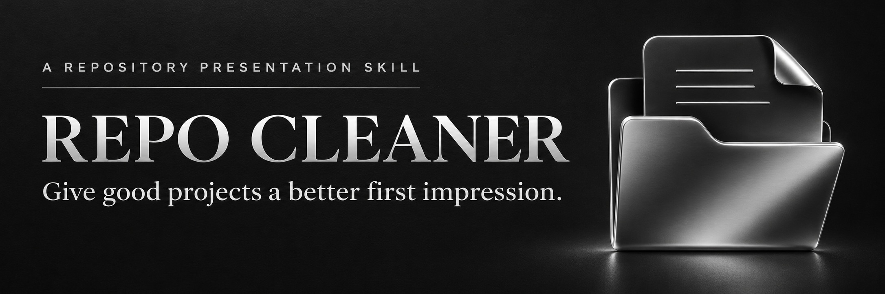
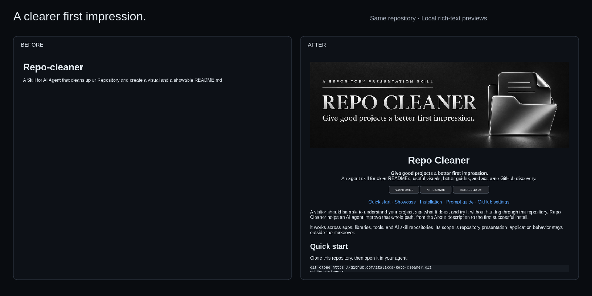

<p align="center">
  
</p>

<h1 align="center">Repo Cleaner</h1>

<p align="center"><strong>Give good projects a better first impression.</strong><br />
An agent skill for clear READMEs, useful visuals, better guides, and accurate GitHub discovery.</p>

<p align="center">
  <a href="skills/repo-cleaner/SKILL.md"></a>
  <a href="LICENSE"></a>
  <a href="docs/installation.md"></a>
</p>

<p align="center"><a href="#quick-start">Quick start</a> · <a href="#showcase">Showcase</a> · <a href="docs/installation.md">Installation</a> · <a href="docs/usage.md">Prompt guide</a> · <a href="docs/github-settings.md">GitHub settings</a></p>

A visitor should be able to understand your project, see what it does, and try it without hunting through the repository. Repo Cleaner helps an AI agent improve that whole path, from the About description to the first successful install.

It works across apps, libraries, tools, and AI skill repositories. Its scope is repository presentation; application behavior stays outside the makeover.

## Quick start

Clone this repository, then open it in your agent:

```sh
git clone https://github.com/italixcs/Repo-cleaner.git
cd Repo-cleaner
```

Give your agent this prompt and a target repository it can access:

```text
Read skills/repo-cleaner/SKILL.md and its referenced resources.
Improve the presentation of [owner/repository]: README, visuals,
installation guides, documentation navigation, and GitHub metadata.
Ask about missing facts or consequential design choices.
Keep the repository's current visibility.
```

For automatic skill discovery, follow the [Codex and Claude Code installation guide](docs/installation.md). Installation routes are checked against host documentation; host runtime testing is tracked separately in that guide. This repository is private during review, so cloning requires access to it.

## Showcase

**The first makeover is this repository.** It started with a title and one sentence. The new first screen adds a visual identity, a specific promise, useful navigation, and a first action.

[](docs/showcase.md)

*These are local rich-text previews, not screenshots of a live GitHub page. [View the source, full-size captures, and capture method](docs/showcase.md).*

| Before | After |
| --- | --- |
| One-sentence introduction | Clear audience, purpose, and scope |
| No useful example | This transformation and copyable prompts |
| No installation path | Short first use plus host-specific guides |
| No discovery plan | About text, topics with evidence, and a social image |

## What the skill handles

| Area | The result |
| --- | --- |
| First impression | A clear promise, strong opening, and a useful next action |
| Visual identity | Banners and assets suited to each project's existing identity |
| Evidence | Actual screenshots, examples, or short demos with honest captions |
| Onboarding | Prerequisites, installation, first success, and deeper guides |
| Discovery | Specific About text, relevant topics, and a prepared social preview |
| Maintenance | Working links, clear asset sources, and fewer stale or repeated sections |

It checks claims before decorating them. Badges need evidence, agent names need real installation routes, and mockups must be labelled. No promised stars, ranking tricks, or invented compatibility.

## From audit to finished repo

1. **Understand:** read the project, audience, existing identity, and repository settings.
2. **Prioritize:** find the few gaps that block understanding or first use.
3. **Build:** improve the README, create useful assets, and connect the guides.
4. **Verify:** check links, commands, desktop/mobile presentation, and metadata read-back.

Ask for **audit only** to get recommendations without edits. Ask for a **full makeover** to implement presentation changes. [See example prompts and expected outputs](docs/usage.md).

## For skill authors

Publishing a skill needs more than a good-looking title. Repo Cleaner checks that the installable folder is complete, separates agent instructions from human-facing docs, and documents installation and support status per host.

The installable package lives in [`skills/repo-cleaner/`](skills/repo-cleaner/). It contains the workflow, three focused references, a reusable brief, and Codex UI metadata. It needs no application server or additional API key of its own; your agent and any optional tools use their normal access and billing.

## Guides and project links

- [Installation and compatibility](docs/installation.md)
- [Usage and prompt examples](docs/usage.md)
- [Showcase and asset sources](docs/showcase.md)
- [About text, topics, and social preview](docs/github-settings.md)
- [Validation record and current limits](docs/validation.md)
- [Contributing and verification](CONTRIBUTING.md)
- [Changes](CHANGELOG.md) · [Report an issue](https://github.com/italixcs/Repo-cleaner/issues)

Inspired by the clear visual presentation and multi-platform guidance in [Understand Anything](https://github.com/Egonex-AI/Understand-Anything). Repo Cleaner uses its own workflow and visual assets.

[MIT](LICENSE) © 2026 Italixcs
