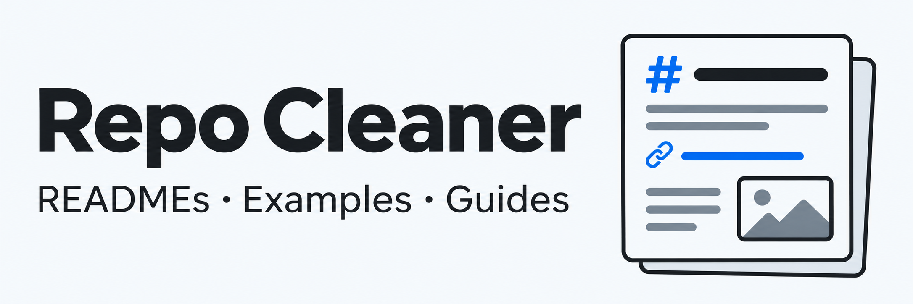

<h1 align="center">
  
</h1>

<p align="center">A skill for improving GitHub READMEs, examples, installation guides, and repository metadata.</p>

<p align="center">
  <a href="LICENSE"></a>
  <a href="skills/repo-cleaner/SKILL.md"></a>
  <a href="docs/installation.md#codex--documented-installation-route"></a>
  <a href="docs/installation.md#claude-code--documented-installation-route"></a>
</p>

<p align="center"><a href="#getting-started">Getting started</a> · <a href="#example">Example</a> · <a href="docs/installation.md">Installation</a> · <a href="docs/usage.md">Usage</a> · <a href="docs/research/README.md">README research</a></p>

Repo Cleaner gives an AI agent a workflow for reviewing and improving a repository's presentation. It reads the project, checks what the README claims, and helps readers find an example, install the project, and reach the right documentation.

It works with apps, libraries, command-line tools, and agent skills. The presentation should fit the project: familiar headings, ordinary badges, useful screenshots, and working links. A small utility can stay small.

## Getting started

Clone this repository and open it in an agent that can read local files:

```sh
git clone https://github.com/italixcs/Repo-cleaner.git
cd Repo-cleaner
```

Then give it a target repository:

```text
Read skills/repo-cleaner/SKILL.md and its referenced resources.
Use it to improve the presentation of [owner/repository].
Ask about missing facts or consequential design choices.
Preserve application behavior and the repository's visibility.
```

For automatic discovery, follow the [Codex or local Claude Code installation guide](docs/installation.md). Those are documented installation routes; native host execution has not been tested.

## Example

[Seed Atlas](https://github.com/italixcs/seedatlas) is our Minecraft Java client mod. These screenshots show its README before and after using Repo Cleaner.

[](docs/examples/seedatlas.md)

*Static, AI-composited comparison from supplied screenshots; the center handle is decorative. [Original before](docs/assets/seedatlas-before.jpeg) · [Original after](docs/assets/seedatlas-after.jpeg).*

The redesign adds a workflow banner, version and license badges, direct download and guide links, and a shorter feature overview. Installation gets its own clear section.

[Comparison details](docs/examples/seedatlas.md) · [Audit-only example](docs/examples/notes-app-audit.md)

## What it does

- Reviews the first screen, examples, installation, deeper guides, and discovery metadata.
- Rewrites and organizes the README around the project's actual users and tasks.
- Creates or improves useful screenshots, demos, and banners when the project benefits from them.
- Checks badges, platform claims, links, and commands against available evidence.
- Prepares or applies authorized About text, topics, and social-preview settings, with their status clearly reported.

Ask for **audit only** to get recommendations without edits, or a **makeover** to implement changes. See [usage examples](docs/usage.md).

## For skill repositories

The workflow checks the complete installable folder, keeps agent instructions separate from public guides, and documents installation per host. It distinguishes tested behavior, a documented installation route, and manual use.

Repo Cleaner's package is in [`skills/repo-cleaner/`](skills/repo-cleaner/). It has no application server or extra API key of its own. Your agent and optional tools use their normal access and billing.

## README research

The [reference notebook](docs/research/source-notes.md) records observations and lessons for all 101 examples in [Awesome README](https://github.com/matiassingers/awesome-readme), its 19 linked tool/recording READMEs, two architecture READMEs, and [Understand Anything](https://github.com/Egonex-AI/Understand-Anything).

That is 123 entries: 122 returned readable source; one returned empty content and is flagged. The review examines source and structure, not live browser appearance or whether a design caused attention or growth. [Coverage and design decisions](docs/research/README.md).

## Documentation

- [Installation and compatibility](docs/installation.md)
- [Usage and prompts](docs/usage.md)
- [GitHub settings handoff](docs/github-settings.md)
- [Presentation decisions and asset sources](docs/showcase.md)
- [Contributing](CONTRIBUTING.md) · [Changes](CHANGELOG.md) · [Issues](https://github.com/italixcs/Repo-cleaner/issues)

## License

[MIT](LICENSE) © 2026 Italixcs
