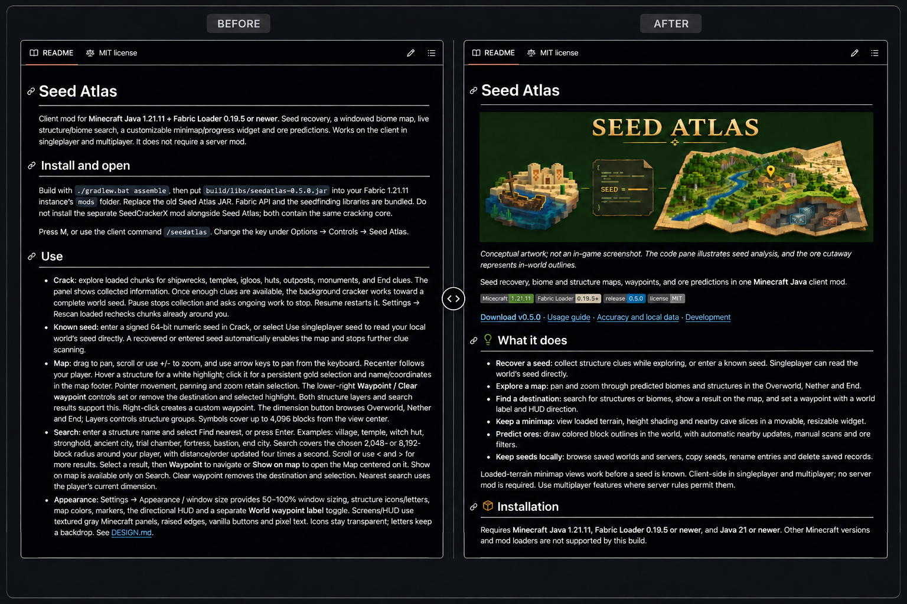

# Seed Atlas README comparison

[Seed Atlas](https://github.com/italixcs/seedatlas) is a Minecraft Java client mod developed by Italixcs. The author supplied these screenshots and reports using Repo Cleaner for the redesign.

## Before and after

- **Before, left:** text-led introduction, source-build instructions, and a long usage section.
- **After, right:** updated structure → seed analysis → atlas concept banner, standard badges, download and documentation navigation, concise feature list, and a dedicated installation section.
- [Unchanged author-supplied comparison](../assets/seedatlas-comparison-source.png): the exact source for the current image, without the added handle.

## Provenance

The current comparison was supplied by the author on 2026-11-18 as `IMG_0417.png` (1536 × 1024). It already contains the two panels, labels and divider. The unchanged upload is preserved above. OpenAI's built-in image generation added a central slider-style handle; the displayed result is an AI-edited composite, so use the unchanged upload for exact text and visual evidence. The handle is decorative, not interactive: GitHub READMEs do not support a draggable image slider.

On 2026-11-18, a source read of the [Seed Atlas default-branch README](https://github.com/italixcs/seedatlas/blob/main/README.md) confirmed the new concept banner, v0.5.0 badges, navigation and feature overview shown on the right. This is source verification, not a new live browser capture. The banner is conceptual artwork, not an in-game screenshot. No gameplay, performance, or code-change claims are made by this comparison.

## Earlier comparison

The [before](../assets/seedatlas-before.jpeg) and [after](../assets/seedatlas-after.jpeg) screenshots supplied on 2026-11-11 remain as historical source material. They are not the inputs for the refreshed image. The current edit prompt is recorded in the [asset notes](../assets/readme-refresh-prompts.md).
