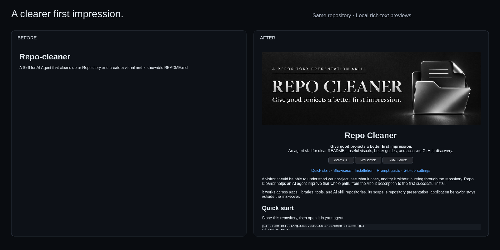

# The first Repo Cleaner makeover

This repository is its own first example. The [original README](examples/original-readme.md) is preserved verbatim from the initial commit. The result is the [current README](../README.md).

## What changed

| Surface | Original | Current version |
| --- | --- | --- |
| Opening | Title and one sentence | Custom banner, clear promise, scope, navigation |
| First use | No instructions | Clone, usable prompt, host-specific installation guide |
| Proof | None | Comparable first-screen captures and source links |
| Structure | README and license | Separate installable skill, public guides, and visual assets |
| Discovery | General About text, no topics | Concrete About/topic proposal with evidence and separate social image |

The discovery row describes prepared settings. See [the current settings handoff](github-settings.md) for their applied or blocked status.

## Capture method and limits

The before and after captures use the same 960 × 760 viewport, Qt 5 QTextDocument, a local rich-text renderer, and a simplified GitHub-like stylesheet. They are local previews, not live GitHub screenshots. The before capture renders the original file; the after capture renders the current README's first screen. The split showcase presents these captures at equal scale. It demonstrates the layout change, not traffic or ranking results.

- [Before capture](assets/readme-before.png)
- [After capture](assets/readme-after.png)
- [Social preview, 1280 × 640](assets/social-preview.png)
- [Asset provenance and maintenance](assets/README.md)

Local previews were inspected at desktop and narrow widths in light and dark themes. Qt rich-text rendering approximates the document layout; GitHub-specific HTML, table scrolling, and exact browser rendering remain unverified. Chromium could not run in this environment because socket creation was restricted. Host runtime behavior was not exercised.

## External inspiration

[Understand Anything](https://github.com/Egonex-AI/Understand-Anything) informed the emphasis on a clear promise, visible proof, and explicit installation paths. Its brand assets and text were not reused. Repo Cleaner is an independent skill.
